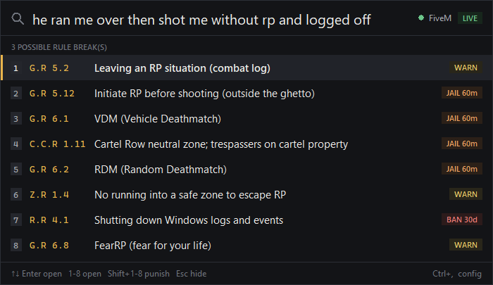
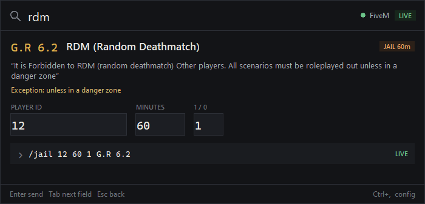
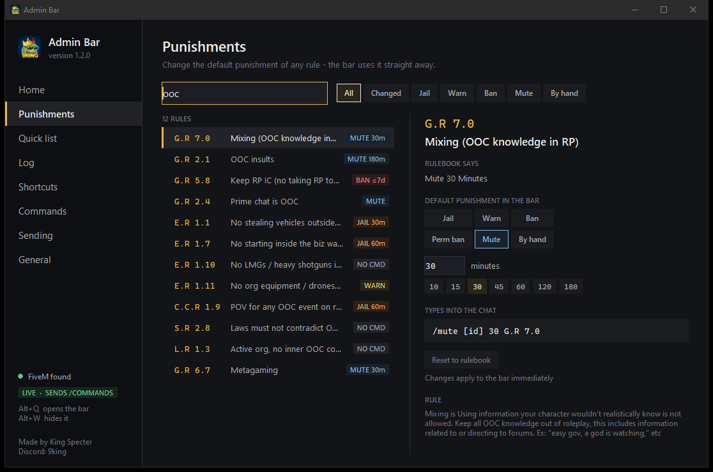

# Admin Bar

A small search bar for FiveM server admins. It sits at the top of the game screen, finds the right rule
while you type, and puts the punishment command into the game chat for you.

By King Specter (Discord: `9king`).

<br clear="left">



I made it because looking up the rule number and typing `/jail 12 60 1 G.R 6.2` by hand every time
gets old fast, especially in the middle of a busy report.

## What it does

- Alt+Q opens the bar over the game, Alt+W hides it.
- Search by rule number, name, slang ("rdm", "vdm", "fear rp") or just describe what happened. Typos are fine.
- Pick a result with its number, enter the player ID, press Enter. The command goes into the FiveM chat.
- Shift + a number punishes straight from the quick list (RDM, VDM, combat log, cheats and so on).
- Several IDs at once: `12 45 7` sends three commands.
- Big bans (30 days and up, permanent) ask for a second Enter.
- Every punishment is written to a log you can open from the settings window or the tray icon.

Supported commands: `/jail` `/unjail` `/warn` `/unwarn` `/block` `/unblock` `/mute`. The reason is the
rule code, e.g. `G.R 6.2`.



## Settings

Right-click the tray icon or press Ctrl+, in the bar. You can change the hotkeys, the default punishment
of any rule, the quick list, the command formats and how the text is typed into the game.



## Install

1. Download `AdminBar.zip` from [Releases](../../releases/latest).
2. Right-click the zip, Extract All.
3. Open the extracted folder and run `Install.cmd`.

That's it. The zip has its own copy of Python, so nothing else needs to be installed and nothing is
downloaded. Admin rights are not needed. It installs to `%LOCALAPPDATA%\Programs\AdminBar`, adds Desktop
and Start menu shortcuts and starts with Windows. Your settings and log live in `%APPDATA%\AdminBar`.

To remove it use "Uninstall Admin Bar" in the Start menu or in Windows' Apps list.

Windows might show a "this file came from the internet" warning for `Install.cmd` because it isn't
code-signed. To avoid it, right-click the zip, Properties, tick Unblock, then extract.

## Building from source

Windows, Python 3.13.2 installed in `C:\Python313` (the Tk files are copied from there).

```
python -I build.py all      rules data, icon, bundled runtime, dist/AdminBar.zip
python -m pytest -q tests   tests (the setup tests run Install.cmd in a sandbox, not on your PC)
```

You can also run it without building: `python "app/Admin Bar.pyw"`.

The rules in `app/adminbar/data/rules.json` are from the server I admin on. For another server, replace
that file with your own rules in the same format.

## Credits

Made by King Specter. Discord: `9king`

If you use it or build on it, keep the credit.

## License

MIT, see [LICENSE](LICENSE).
